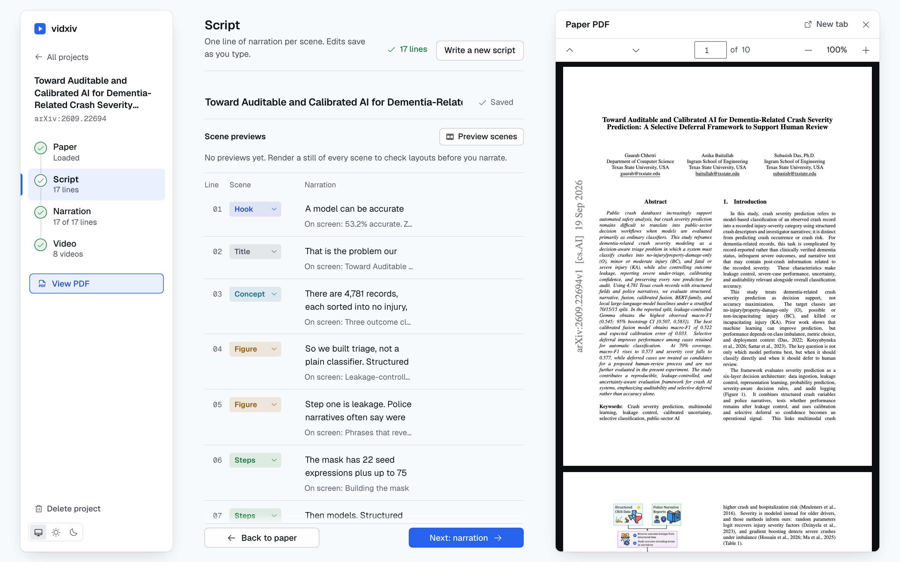
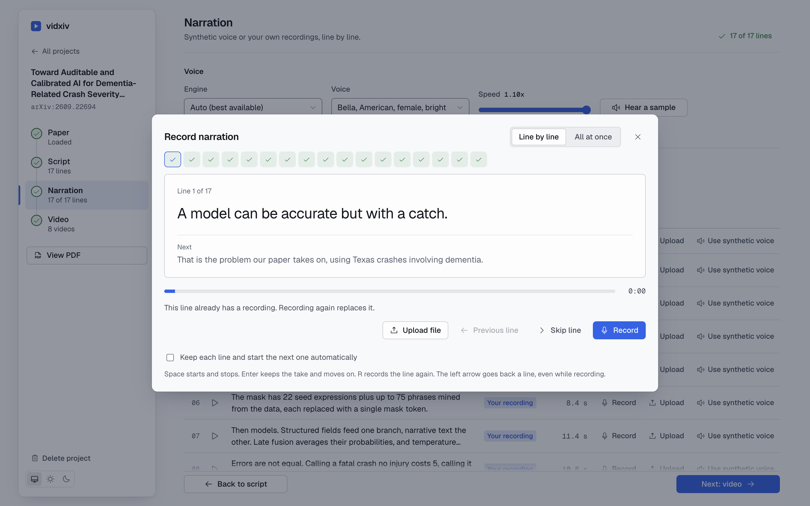
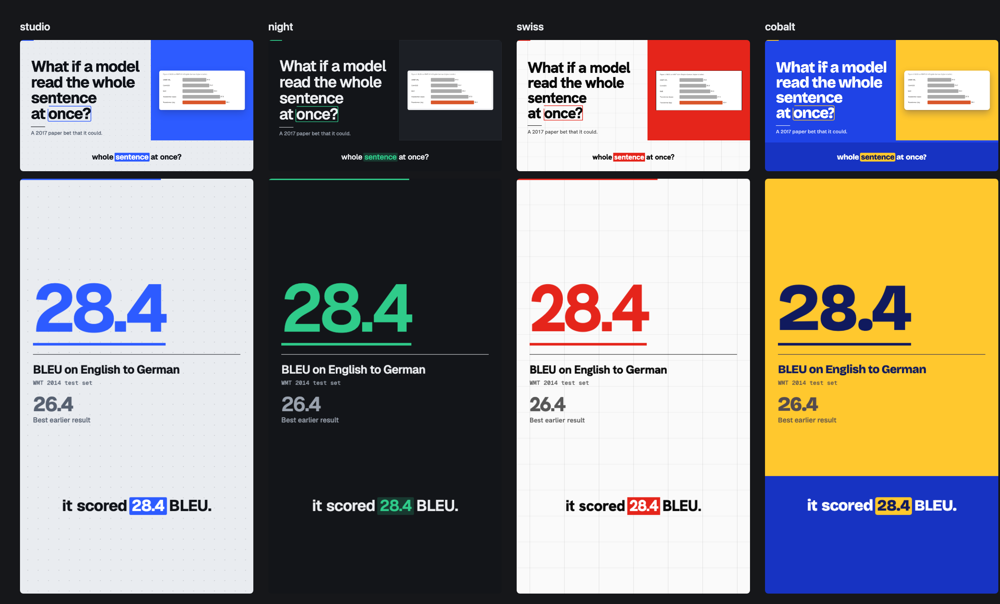

# vidxiv

Turn an arXiv paper or a PDF into a narrated explainer video. Runs on your machine. The script is written by the
Claude Code or Codex CLI you already have installed, the voice is a local model, and the video is rendered with Remotion.







## What it does

1. **Reads the paper.** Give it an arXiv id, an arXiv link, or a PDF. It extracts the text and cuts the figures out of the PDF locally, which costs no tokens. A built-in PDF viewer opens beside your work so you can check the script against the paper.
2. **Writes the script.** An agent (Claude Code or Codex) reads the paper and writes narration plus a scene for every line,
   using the `paper-video` and `unslop` skills in this repo. Or you paste your own narration, or upload a recording and use its transcript.
3. **Narrates it.** A local neural voice (Kokoro), macOS system voices, a recording you make in the browser,
   or one long audio file that gets cut into lines by matching it against the script. Mix them per line.
   The recording studio has two modes: line by line (Space starts and stops, Enter keeps the take, R records again, the left arrow goes back a line, even while recording)
   and all at once (read the whole script in one take, vidxiv cuts it into lines).
4. **Renders it.** Vertical (Shorts, Reels, TikTok), landscape (YouTube) or square, with word-synced captions, music and quiet sound effects,
   mastered to about -14 LUFS.

You choose the length (short 45 s, medium 90 s, long 3 min, or any custom value from 20 s to 10 min) and the level of detail
(overview, balanced, in depth). Very long videos use a lot of agent tokens, and the app warns you above 5 minutes.

Four looks are built in: `studio` (cool light, blue), `night` (graphite, emerald), `swiss` (white grid, signal red) and `cobalt` (saturated blue, yellow).
Choose one or several (you get one video per look from the same narration), or leave it on Auto and the agent picks the one that suits the paper.
Rendering again never deletes earlier renders, and replaced scripts are kept under Earlier scripts so you can restore them. The design rules live in `skills/video-taste/`.

Scenes are drawn from a fixed set: hook, title, concept, steps, figure (with zoom and callouts), stat, bars, compare, equation, quote, outro.
The agent only fills in content, so a bad answer fails validation instead of breaking a render.

## Requirements

- Python 3.11 or newer and [uv](https://docs.astral.sh/uv/)
- Node.js 20 or newer and npm
- ffmpeg
- For script writing, at least one of the [Claude Code](https://claude.com/claude-code) or [Codex](https://github.com/openai/codex) CLIs, signed in.
  Without one, you can still paste your own script and vidxiv assigns scenes with simple rules.
- Network access on first use: the video engine (npm), the Kokoro voice model (about 340 MB), the speech-timing model (about 150 MB),
  a headless Chrome for Remotion, and Google Fonts at render time.

## Start

```bash
uv sync
./run.sh            # or: uv run vidxiv serve
```

Open http://127.0.0.1:8420. The first render installs the video engine, which takes a minute or two.
`uv run vidxiv doctor` shows what is missing.

## Making a video

1. Enter an arXiv id (for example `1706.03762`) or drop a PDF.
2. Choose how the script is written, a length, a level of detail and an agent, then select **Write script**. Edit any line, scene or figure. Use **Preview scenes** to see stills.
3. Pick a voice, or record (line by line or all at once) or upload your own. Open **View PDF** at any time to check the script against the paper. Select **Generate narration**. Rendering narrates anything still missing.
4. Choose formats, look, captions and music, then select **Render video**.

Everything for a project is in `workspace/jobs/<id>/`: the paper, figures, `storyboard.json`, narration clips and the finished MP4 files.

### From the command line

```bash
uv run vidxiv make 1706.03762 --seconds 90 --detail balanced --look swiss --look night --format Vertical --format Landscape
uv run vidxiv make paper.pdf --agent codex --script my-narration.txt --audio my-reading.m4a
```

## How the agent is used

For each script request vidxiv prepares the project folder and runs the CLI inside it:

- `claude -p ... --permission-mode acceptEdits` with only Read, Write, Edit, Glob, Grep and the `./validate.sh` helper allowed.
- `codex exec --sandbox workspace-write` in the same folder.

The folder contains `skills/paper-video`, `skills/video-taste` and `skills/unslop` (also placed in `.claude/skills`), `brief.json`, `paper/paper.md`, the figure images, and the storyboard schema.
The agent writes `storyboard.json` and runs `./validate.sh` until it passes. vidxiv validates the file again before using it, retries with the errors if needed,
and cleans dashes and curly quotes mechanically. The paper text is treated as data, not instructions.

To use the skills outside vidxiv, run `uv run vidxiv install-skills`. It copies `paper-video`, `video-taste` and `unslop` to `~/.claude/skills` and `~/.agents/skills`.

## Project layout

```
vidxiv/            Python package: API server, jobs, paper parsing, agents, voice, render
vidxiv/web/        the web UI (plain HTML, CSS and ES modules, no build step)
engine/            Remotion project that draws the scenes (see engine/README.md)
skills/            paper-video, video-taste and unslop skills used by the agents (design-taste-frontend is the source for the UI design rules)
docs/              engine contract and screenshots
tests/             pytest tests for the pure logic
```

The storyboard format lives in `vidxiv/schema.py`. The props the engine reads are described in `docs/ENGINE_CONTRACT.md`.

## Limits

- Local figure extraction relies on "Figure N" captions. When it misses something the video needs, such as a results table, the script agent looks at the page (`./page.sh N` renders one page image) and adds a cropped region. The agent reads the extracted text, not the whole PDF, to keep token use down. Scanned PDFs have no text and are rejected.
- Narration timing for your own recordings comes from a speech model and can be off on heavy accents, numbers and symbols. Captions fall back to estimated timing for words it cannot match.
- Equations are rendered from LaTeX written by the agent. If a formula does not parse, the scene shows it as plain monospace text.
- The agent can misread a paper. Read the script before rendering, especially numbers.

## Development

```bash
uv run pytest
cd engine && npm run check     # typecheck and render sample stills
cd engine && npm run studio    # Remotion Studio on the sample storyboard
```

## License

MIT
